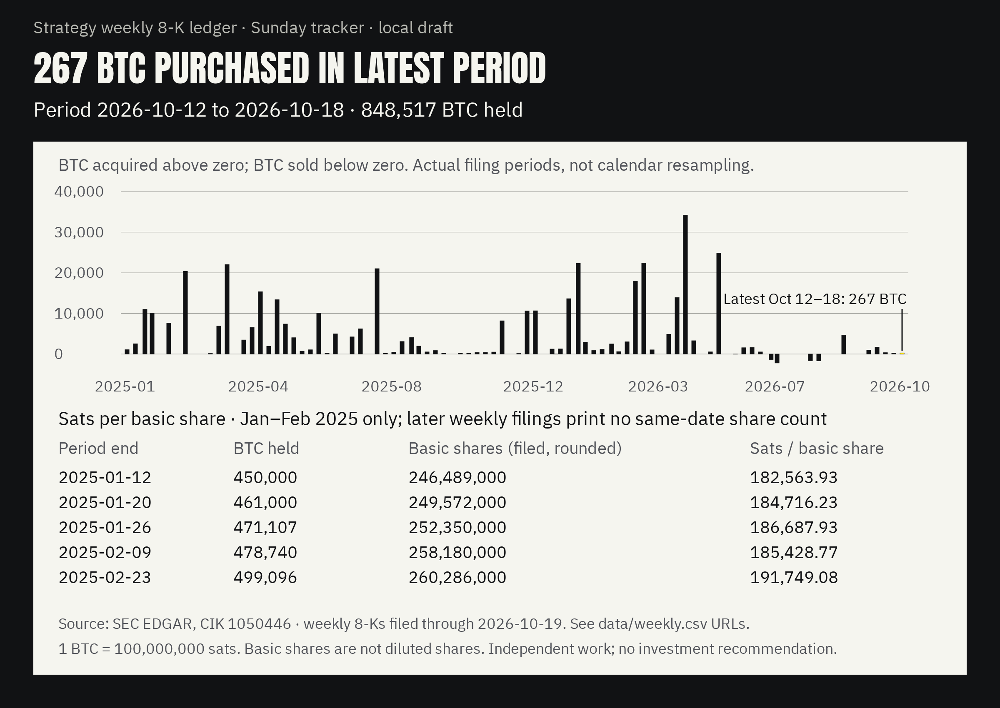

# Strategy 8-K ledger: trace weekly treasury fields to SEC filings

[](https://github.com/RahilBhavan/strategy-8k-ledger/actions/workflows/ci.yml)



A local Python CLI extracts Strategy's weekly bitcoin, ATM issuance, remaining capacity, repurchases and disclosed USD balances. The frozen corpus contains 97 period rows from 93 weekly updates, through the October 19, 2026 filing. Values retain source URLs and dates; consistency checks expose rounding exceptions instead of silently correcting them.

## What it does

- Reads 147 candidate 8-K/8-K/A filings filed January 6, 2025–October 19, 2026; writes 97 period rows and 432 instrument/program/action rows. See `data/filings.csv`, `weekly.csv` and `instrument_weekly.csv` after restore/build.
- Latest period, October 12–18: 267 BTC purchased, 848,517 BTC held, $22M MSTR ATM net proceeds and $4.83B USD Reserve. See `data/weekly.csv` and [primary filing](https://www.sec.gov/Archives/edgar/data/1050446/000119312526424688/mstr-20261019.htm).
- Checks holdings/cost rolls, dates, stated averages, ATM totals and authorization rolls. No unexplained breaks in the frozen corpus; known exceptions remain visible in `data/checks.csv`.
- Produces a purchase/sale chart and 5 sats/basic-share ratios with same-date filed denominators in January–February 2025. The separate inherited share roll-forward is a labeled model, excluded from this chart and Ask Filings.

## How it works

`ledger/edgar.py` caches source bytes with a SHA-256 manifest. Strict prose/table readers reject unknown layouts; `build.py` writes CSVs, `checks.py` reconciles them and `evidence.py` supplies numbered normalized source sections per field. Small `data/frozen/` shards preserve outputs and the manifest in Git; a 3.9 MB archive preserves all 184 original public source resources for offline hydration. `data/contract.json` pins table, manifest and archive hashes.

## Run it

Python 3.11+; tested with Python 3.14.7. No dependencies for the CLI, tests or SVG chart.

```bash
git clone https://github.com/RahilBhavan/strategy-8k-ledger.git
cd strategy-8k-ledger
python -m ledger restore
python -m ledger hydrate
python scripts/verify_contract.py
python -m unittest discover -s tests -v
python -m ledger all
python -m ledger diff
python -m ledger evidence --period 2026-10-18 --field btc_held
```

Observed: **45 tests pass** on Python 3.14.7. The frozen restore, hydrate, tests and demo are offline, including an empty source cache. Python 3.13.7 is pinned in CI. There is no separate typechecker; CI also compiles every Python module.

`build --refresh` opts into live discovery and needs an identifying `SEC_USER_AGENT` containing a contact email. It does not rewrite frozen shards until `snapshot` is explicitly run. SEC failures or changed hashes refuse; no substitute data is generated. For consumer pins and trust boundaries, see the [v1 dependency contract](docs/dependency-contract.md).

Optional PNG export (requires `uv` and an installed Playwright Chromium; no account). A fresh browser download was not exercised; the local installed browser was used:

```bash
UV_CACHE_DIR=$HOME/scratch/strategy-8k-ledger/uvcache uv run --with playwright==1.63.0 python scripts/render_chart.py
```

The SVG/HTML embeds the bundled OFL-licensed Anton and IBM Plex Sans fonts; system sans-serif is the fallback. The generated PNG above is committed; SVG/HTML exports can be rebuilt locally. The chart is reviewed at 1200×850; the dense 400px overview needs zoom.

## Repository layout

- `ledger/`: discovery, parser, checks, evidence, share model and chart CLI.
- `data/frozen/`: small CSV shards of outputs and source manifest.
- `data/raw/`: ignored hydrated source cache.
- `data/sources/`: original public SEC bytes with provenance and rights notes.
- `tests/`: actual-source, mutation, integrity and retry tests.
- `figures/`: chart brief, alt text and local exports.
- `scripts/`: optional PNG exporter.
- `docs/`: scope, method, schema and verification receipts.

## Documentation

- [Public design system](DESIGN.md): Rahil Design 3.3.0, shared tokens and visual review rules.

- [Spec](docs/spec.md): accepted v1 and criteria.
- [Method](docs/method.md): fetching and strict parsing.
- [Schema](docs/schema.md): field definitions and units.
- [Evidence](docs/evidence.md): source lines, formulas and missingness.
- [Consistency](docs/consistency.md): tolerances and known exceptions.
- [Sources](docs/sources.md): primary-site review and coverage limits.
- [Verification](docs/verification.md): exact checks and artifact limits.
- [Dependency contract](docs/dependency-contract.md): versioned columns, hashes and consumer pins.
- [Review](docs/review.md): proven fixes and remaining limits.
- [Publication](docs/publication.md): public source pin, fresh-clone and CI evidence.

## Sources

SEC EDGAR CIK 1050446, plus 8 quarterly/annual cover-page share anchors. Review as of October 21, 2026; latest economic date October 18. All 184 cached resources are hashed in the frozen manifest. Primary pages were spot-checked, not every filing manually reviewed. See [source review](docs/sources.md). The client/block-parser approach adapts Rahil’s dat-accretion work; see attribution in the method. Third-party filings retain their own rights.

## Scope and limits

- Independent local research, not affiliated with Strategy. No scheduler, trades or web deployment.
- Recent submissions index only; no claim of complete historical discovery. Overlapping/amended weekly periods and conflicting tables refuse pending review; new layouts require review.
- Filed rounded values are not audited transaction-level records. Blank means missing/inapplicable.
- No current sourced weekly denominator: no current sats/share ratio is fabricated. The model does not capture all share flows.
- October 28 daily-dividend proposal remains pending as of October 21; no enactment assumption.

## License

No license file yet. No license has been selected; third-party filings and font assets retain their own terms.

Part of [Rahil Bhavan's projects](https://github.com/RahilBhavan).
